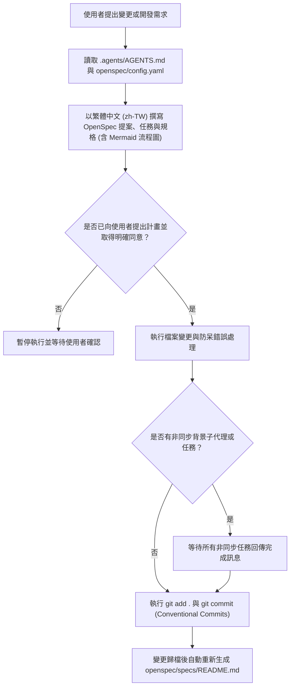

# Spec Delta

## Purpose

定義 `font_rename (ONLYOFFICE 字型名稱批次中文化工具)` 專案的 AI 代理操作鐵律（`.agents/AGENTS.md`）與 OpenSpec 規格驅動開發設定（`openspec/config.yaml`），確保所有代理協作、版本控制與規格文件產出皆遵循一致的繁體中文規範與安全防呆流程。

## ADDED Requirements

### Requirement: 專案代理鐵律規範檔
系統 MUST 於 `.agents/AGENTS.md` 維護專案鐵律（Rules），明確定義目錄規範（統一使用複數 `.agents/`，嚴禁單數 `.agent/`）、執行前確認、嚴格的版本控制、非同步任務同步、防呆與錯誤處理、流程圖文件化，以及變更歸檔後自動重新生成 `openspec/specs/README.md`。

#### Scenario: 檢查代理鐵律設定檔與目錄規範
- **WHEN** 代理或開發者檢視專案根目錄下的代理設定
- **THEN** `.agents/AGENTS.md` 必須存在且完整包含七項專案鐵律，同時專案內不得存在單數 `.agent/` 目錄

#### Scenario: 變更執行前確認與版本控制流程
- **WHEN** 代理準備修改檔案、執行指令或進行重大更新
- **THEN** 代理必須先提出計畫並取得使用者明確同意，且在非同步任務（若有）皆完成後執行 `git add .` 與 `git commit`

### Requirement: OpenSpec 專案設定與繁體中文規範
系統 MUST 於 `openspec/config.yaml` 設定 `spec-driven` 架構、專案名稱 `font_rename (ONLYOFFICE 字型名稱批次中文化工具)`、技術棧 `Python 3.8+`、Conventional Commits 與 Spec-driven 開發慣例，並強制規範所有 `proposal`、`tasks`、`specs` 產出物以繁體中文（`zh-TW`）撰寫。

#### Scenario: 讀取 OpenSpec 專案設定產生規劃文件
- **WHEN** OpenSpec 工作流讀取 `openspec/config.yaml` 產生 `proposal`、`tasks` 或 `specs` 文件
- **THEN** 設定檔必須提供專案名稱、技術棧與 `zh-TW` 語言限制規則，使所有產出文件皆以繁體中文撰寫
